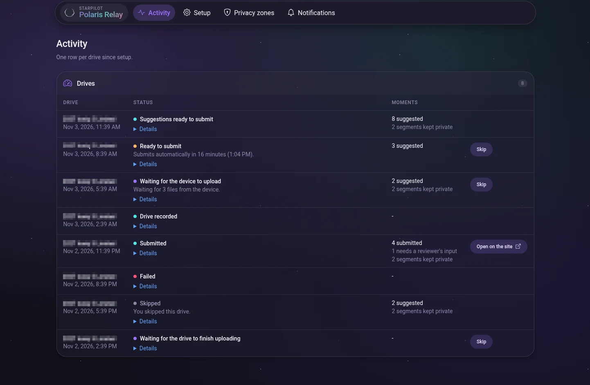
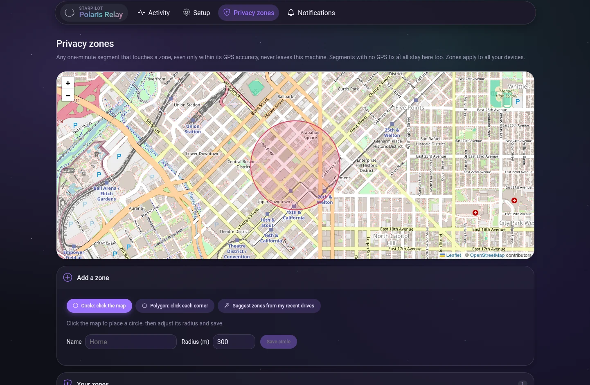

# Polaris Relay

A client for the [Operation Polaris API](https://polaris.firestar.link/docs/api) that contributes your StarPilot drives
for you. It runs on your own machine (a PC, a VPS, a Raspberry Pi), finds the moments worth submitting in each drive,
and submits them through the API with an access token you can revoke at any time. No waiting on comma connect, no
"upload all", no making routes public, no pasting links.

It's also a working example of the API, if you're writing a client of your own.

Your comma token stays on your machine; the site never sees it. And it's not a firehose:

- It sends the low-res logs (qlogs) of the segments outside your zones, so the site can find the moments worth
  contributing, and video and full logs only for the segments those moments need. Never whole drives.
- Anything inside your **privacy zones** never leaves your machine: not its logs, not its video. That covers any
  one-minute segment where any position the logs carry touches a zone (within its accuracy), including a navigation
  route ending in one; any segment without a good GPS fix; a drive's first and last segment when they start or end
  near a zone or before GPS locks; and optionally the segments around them.
- It only picks up drives that start after you set it up.

Working files are deleted as soon as a drive is done. The database keeps only what the activity list shows, for 30
days. Nothing is sent anywhere except comma, the site, your notification services, and a daily version check (which
you can turn off).

## Screenshots





## Before you start

- A comma device running StarPilot, paired to your comma account.
- An account on the [Operation Polaris site](https://polaris.firestar.link), with each device verified there: enter one of its routes on the site and
  follow the device check once.
- On the site, go to **Profile → Access tokens** and create one with **Submit drives** and **Record drives**.

## Run it

```sh
mkdir polaris-relay && cd polaris-relay
curl -o docker-compose.yml https://raw.githubusercontent.com/StarPilotHQ/polaris-relay/main/deploy/docker-compose.example.yml
mkdir data && sudo chown 10001:10001 data   # the container runs as uid 10001
htpasswd -nbBC 12 admin 'choose a password'     # paste the output into AUTH_PASSWORD, writing each $ as $$
$EDITOR docker-compose.yml
docker compose up -d
```

Open http://localhost:8080, sign in and follow Setup:

1. Paste a comma token from [jwt.comma.ai](https://jwt.comma.ai). The page shows when it expires and warns you a week
   before.
2. Paste your access token from the site.
3. Enable your devices, and choose per device: submit automatically or only suggest, and whether to record drives.
   Only drives that start after you enable a device are picked up. With **Only suggest**, each drive links to the site
   to submit it yourself; that means making the route public on comma, which shares every segment, privacy-zone
   segments included, and the site's picker doesn't know about your zones.
4. Draw your privacy zones on the map. "Suggest zones from my recent drives" proposes places your drives often start
   or end, worked out on your machine from comma's route list.
5. Choose how files reach the site (below), then finish setup.

### How files reach the site

- **Relay through this machine** (the default): Polaris Relay downloads the needed segments from comma and uploads
  them to the site. Your route is never public. It costs your bandwidth: roughly 75 to 115 MB per segment, down and
  up again.
- **Make the route public briefly**: the route is made public, the site copies the segments from comma, then the route
  is made private again. Almost no bandwidth here, but while it's public anyone with the route's name can read the
  whole route, privacy-zone segments included. It's made private again as soon as the copy finishes, and after 6
  hours at most (Advanced settings), unless Polaris Relay is stopped mid-step; it makes it private when it starts
  again.

### Before a drive is submitted

Once its files are in place, a drive waits as **Ready to submit** with a countdown: 30 minutes by default, set under
Advanced settings (0 submits right away). Until it's submitted, **Skip** on its row stops Polaris Relay working on it
and submits nothing, so you can leave the drive out or pick your own ranges on the site. The site takes one submission
per route, so whoever submits first decides. Cancelling an upload in comma connect doesn't stop a drive: it asks the
device again later. Skip the drive instead.

## Settings

Only what the page can't set is configured through the environment:

| Variable | |
|---|---|
| `AUTH_PASSWORD` | One htpasswd line with a bcrypt hash: `htpasswd -nbBC 12 admin 'password'`. In docker-compose, write each `$` as `$$` |
| `INSECURE_ALLOW_NO_AUTH=1` | Turn off the sign-in, when your reverse proxy already asks for one (Traefik basic auth, Authentik forward auth). Logged as a warning |
| `ALLOWED_HOSTS` | Comma-separated host names you open the page on, with the port if it isn't 80/443 (`relay.example.com`, `localhost:8080`). Required. `*` allows any and is logged as a warning |
| `ALLOWED_ORIGINS` | Origins forms may come from (`https://relay.example.com`). Defaults to `http://` and `https://` of each allowed host. `*` is logged as a warning |
| `DATA_DIR` | Default `/data` |
| `TRUSTED_PROXIES` | Comma-separated addresses of your reverse proxy, so the sign-in lockout counts visitors' addresses from `X-Forwarded-For` |

Sign-in cookies are marked Secure once you name an https origin in `ALLOWED_ORIGINS`. Changing `AUTH_PASSWORD` signs
everyone out.

The container refuses to start, and logs why, without `AUTH_PASSWORD` or `INSECURE_ALLOW_NO_AUTH=1`, or without
`ALLOWED_HOSTS`. The host and origin checks matter: the page holds your comma token, which can do anything with your
devices, so it must not answer other sites' requests through your browser.

A request those checks refuse gets a plain 400 or 403, and the log says why: look there if the page won't open.

Reverse-proxy examples (Traefik, Caddy, nginx, Authentik forward auth) are in [deploy/](deploy/).

## Notifications

Under **Notifications**, add Discord, ntfy, Telegram, email or any [Apprise](https://github.com/caronc/apprise) URL,
and send a test. You're told when your comma token expires within a week, when the API version it uses is deprecated
(and again when it gets an end date), when a device needs verifying on the site again, and when a drive keeps failing. A daily summary is optional. Nothing is sent
per drive.

## Updates

The page shows a notice when a newer image exists (checked once a day against GitHub's container registry; turn it
off in Setup). Updating is up to you, for example with Watchtower. When the site deprecates the API version this one
uses, the page says so and when it stops working; update before then.

## Development

```sh
uv sync
uv run pytest -q
```

To run it from source, point `POLARIS_HOST` at the site, or at a local copy of it (`http://localhost:8000`):

```sh
POLARIS_HOST=https://polaris.firestar.link ALLOWED_HOSTS=localhost:8080 INSECURE_ALLOW_NO_AUTH=1 DATA_DIR=var \
  uv run polaris-relay serve --host 127.0.0.1
```

Then open http://localhost:8080. The Docker image has `POLARIS_HOST` built in. AGENTS.md has how it's built and the
comma behavior [comma's API docs](https://api.comma.ai) don't cover.

Third-party code: [htmx](https://htmx.org) 2.0.4 (0BSD), [Leaflet](https://leafletjs.com) 1.9.4 (BSD-2-Clause),
StarPilot's Galaxy styles (MIT) and [Bootstrap Icons](https://icons.getbootstrap.com) 1.11.3 (MIT), vendored under
`relay/web/static/vendor/` with their licenses. Map data © OpenStreetMap contributors.

## License

MIT
